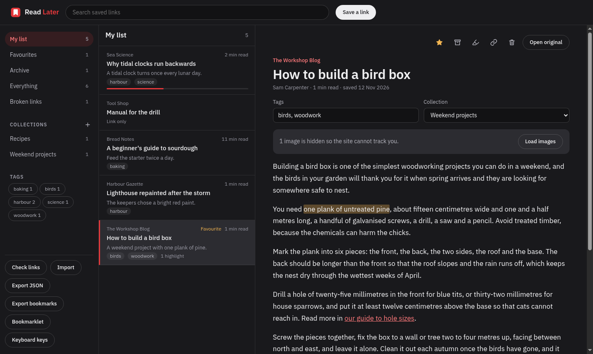

<div align="center">

# Starfire Read Later

**Your own free take on Pocket and Raindrop. Save links from anywhere, read a clean copy without the clutter or the trackers, highlight, tag and search it all, kept in one SQLite file on your own server.**

[](https://www.python.org/)
[](https://flask.palletsprojects.com/)
[](https://sqlite.org/)
[](LICENSE)

</div>



---

## Overview

Starfire Read Later is a small self-hosted read-later and bookmarks app. It has its
own sign-in for one owner account, so a copy runs on its own. It can also
sit behind a sign-in proxy: the author runs it behind the starfire sign-in
like Keep Notes and Tasks, where Caddy checks the sign-in, then passes the
request to Starfire Read Later on `127.0.0.1`.

- **Save a link** three ways: paste it into Save a link, use the
  **bookmarklet** on any page, or open `/save?url=...` (which is also the
  phone **share target** once the app is added to the home screen).
- **A clean, readable copy.** The page is fetched once, the article is found
  with readability-lxml, and title, site name, author, date and reading time
  come from the page's own tags. A heading that only repeats the title is
  left out.
- **Nothing tracks you while you read.** Article HTML is cleaned with an
  allowlist (no scripts, frames, forms, styles, event handlers or
  `javascript:` links). **Images are held back by default**; "Load images"
  for one article fetches them through Starfire Read Later, so the site never sees
  your browser, cookies or address.
- **My list, Favourites, Archive, Everything** and **Broken links**,
  **collections** (one per link) and **tags** (many per link).
- **Full-text search** over titles, site names, article text and your notes
  (SQLite FTS5, prefix matching, so `sour` finds "sourdough").
- **Highlights**: select text in the article and press `h` (or the
  highlighter button). Highlights are listed under the article and painted
  back into it every time you open it, even across paragraphs.
- **A note per article**, saved as you type.
- **Read progress**: where you stopped is saved as you scroll and restored
  when you come back; the list shows a progress bar.
- **Dead-link check** on demand: one link from the reader, or every link in
  the background with Check links. `404` and `410`, or a site name that no
  longer exists, count as gone and show up under Broken links.
- **Export and import**: JSON (everything, including the saved text,
  highlights and notes) and Netscape bookmarks HTML (what every browser,
  Pocket and Raindrop read and write).
- **Keyboard keys**: `j` / `k` next and previous, `f` favourite, `a`
  archive, `h` highlight, `v` open the original, `n` save a link, `/`
  search, `?` the list.
- Works on a phone: one pane at a time, lists, collections and tags behind
  the menu button.
- A small **read-only JSON API** for other programs, such as Arty reading
  out what is waiting in your list.
  As deployed it is only reachable from the server itself (the app
  listens on `127.0.0.1` and Caddy lets in only a signed-in browser), so a
  program on another machine, Arty's brain included, cannot call it yet;
  that needs a token or a second listener first.

---

## Requirements

- Python 3.11+

---

## Install and run on your own machine

```bash
git clone <this repo> read-later
cd read-later
python3 -m venv .venv
.venv/bin/pip install -r requirements.txt
cp .env.example .env
.venv/bin/python -m readlater
```

Then open `http://127.0.0.1:8099` and make the owner account (see below).
Everything is stored in `./data`.

`AUTH_MODE=local` switches the sign-in off for a copy only you use on this
machine: it then refuses to listen on anything but `127.0.0.1`, `::1` or
`localhost`.

---

## First run and sign-in

Starfire Read Later has its own sign-in, switched on by default (`AUTH_MODE=builtin`).
There is one owner account and no sign-up page.

1. Start it (`.venv/bin/python -m readlater`) and open
   `http://127.0.0.1:8099`. With no account yet every page goes to
   **Set up**.
2. The app writes a one-time setup code to its log when it starts, a line
   like `no owner account yet: open /setup and enter the setup code ...`.
   Enter that code, a user name and a password (10 characters or more,
   twice). The code stops anyone else who reaches the page first from
   making the account, and it works once: if the owner file is ever
   deleted, the next visit to **Set up** writes a new code to the log.
3. After that, every page goes to **Sign in** until you sign in. A session
   lasts 30 days. `/signout` signs out on every device.

How it is protected:

- The password is stored as an scrypt hash in `DATA_DIR/owner.json`
  (mode 600), never in plain text.
- 5 wrong passwords or setup codes from one address within 15 minutes lock
  that address out for the rest of the 15 minutes (`429`). Attempts sent
  at once are counted before they are checked, IPv6 addresses count by
  their `/64` network, and after 100 failures from everywhere within 15
  minutes each address gets one try and each network three (IPv4 by `/24`,
  IPv6 by `/48`). A right password from a locked address is refused too.
- During such an attack one wrong password from a neighbour on the same
  provider network does not keep your new browser out: that takes three
  wrong passwords within 15 minutes from three of their addresses (IPv4)
  or three of their home lines (IPv6, where a line's whole `/56` counts as
  one address).
- A browser that has signed in before keeps a signed device cookie and has
  its own 5 tries, so a stranger who locks out your address (or the
  address of the proxy in front) cannot lock you out of that browser.
  During an attack from many networks that browser is the way in.
  Making a new owner account ends every device cookie of the old one.
- The session cookie is `HttpOnly`, `SameSite=Lax` and signed with the app's
  secret key. It is `Secure` everywhere except plain `http` on `localhost`,
  `127.0.0.1` or `[::1]` (`SECURE_COOKIES=auto`). On a plain `http` address
  on your home network the browser drops a `Secure` cookie and the sign-in
  page says so: use https, or set `SECURE_COOKIES=false` there.
- Forget the password? Stop the app, delete `DATA_DIR/owner.json`, start it
  again and set up a new owner with the new setup code from the log. Your
  data stays.

Behind a reverse proxy for https, with the own sign-in still on: list the
proxy's address in `TRUSTED_PROXIES` so the lockout counts each visitor's
address from `X-Forwarded-For` instead of the proxy's (the header is read
only from those addresses), and put the public host name in
`ALLOWED_HOSTS`. By default the own sign-in answers only on `localhost`,
`127.0.0.1`, `[::1]`, IP addresses and this machine's own name; any other
`Host` gets `421`, so a web page cannot reach a copy on your machine by
DNS rebinding.

To run it behind a sign-in proxy instead, set `AUTH_MODE=proxy` and list the
proxy's address in `TRUSTED_PROXIES`. The user header is then believed only
from those addresses; in the default mode it is never read.

---

## Configuration (`.env` or environment)

| Key | Description |
|---|---|
| `AUTH_MODE` | `builtin` (default): the app's own sign-in, one owner account. `proxy`: trust the user header from a sign-in proxy listed in `TRUSTED_PROXIES`. `local`: no sign-in, loopback only, and only for the host names `localhost`, `127.0.0.1` and `[::1]` with `PORT` (any other `Host` gets 421, so a web page cannot reach the app by DNS rebinding). |
| `BIND_HOST` / `PORT` | Where the app listens. Default `127.0.0.1:8099`. |
| `DATA_DIR` | Database (`read-later.db`), the owner account (`owner.json`) and the secret key (`secret_key`). Default `./data`. |
| `TRUSTED_PROXIES` | Addresses or networks whose user header is believed in `proxy` mode, comma separated. No default: `proxy` mode refuses to start without it. A network with host bits set (`10.0.0.5/8`) or one that reaches public addresses (`0.0.0.0/0`, `::/0`) stops the app at start-up; a single public address is allowed. In `builtin` mode, the proxies whose `X-Forwarded-For` gives the visitor's address to the lockout. |
| `ALLOWED_HOSTS` | In `builtin` mode, the only host names the app answers on, comma separated (others get 421). Empty: `localhost`, `127.0.0.1`, `[::1]`, IP addresses and this machine's own name. |
| `SECURE_COOKIES` | `auto` (default): the session cookie is `Secure` except on plain `http` to `localhost`, `127.0.0.1` or `[::1]`. `true` or `false` force it. Only used in `builtin` mode. |
| `USER_HEADER` | The header the proxy fills in. Default `X-Forwarded-User`. |
| `ALLOWED_USERS` | Optional comma separated list; any other user header value is refused. |
| `LOCAL_USER` | The user name shown in `local` mode. Default `local`. |
| `SECRET_KEY` | Optional. Without it a random key is made once in `DATA_DIR/secret_key` (mode 600). It signs CSRF tokens and image links. A key shorter than 32 bytes stops the app at start-up. |

---

## Saving links

**Save a link** (or `n`): paste the address, add tags and a collection if
you like. Starfire Read Later fetches the page there and then. If the page cannot be
fetched, or is a PDF or another file, the link is still kept, with the
reason, and a **Fetch again** button in the reader.

**Bookmarklet**: open Bookmarklet in the sidebar and drag the button to your
bookmarks bar. Clicking it on any page opens a small Starfire Read Later window with
that page's address filled in; press Enter or Save.

**From a phone**: add Starfire Read Later to the home screen from the browser menu,
then use Share on any page and pick Starfire Read Later. Any app can also open
`https://read.example.com/save?url=<address>`. If the shared text only has
the link inside it (some Android apps do this), the first `http` or `https`
address in it is used.

`/save` never saves anything by itself: it opens the app with the save
dialog filled in, and the save happens when you confirm. A link that would
save on its own could be triggered by any other website you visit while
signed in.

If you are signed out, the starfire sign-in comes first and the shared link
is not carried through it; share again after signing in.

---

## How it is kept safe

**Sign-in and writes** work exactly like Keep Notes and Tasks:

- In `builtin` mode (the default) a request is signed in only with the
  owner's session cookie; see [First run and sign-in](#first-run-and-sign-in).
  A user header is never read.
- In `proxy` mode a request is only signed in when it comes from an address
  in `TRUSTED_PROXIES` **and** carries a non-empty `USER_HEADER`. The same
  header sent from anywhere else is ignored and the request gets `401`.
  Everything needs it except `/api/health`.
- The Caddy block in `deploy/` removes any `X-Forwarded-User` the visitor
  sends, checks the starfire session with `forward_auth` against
  `/api/auth/users` (the admin account only), then sets
  `X-Forwarded-User` itself, to `SIGNED_IN_USER` from `deploy/site.env`.
  `ALLOWED_USERS` in the server env file is set to the same name and makes
  Starfire Read Later refuse anything else.
- Every write needs the `X-CSRF-Token` header from `/api/session`, and a
  write whose `Origin` is another host is refused.
- Pages ship a strict Content Security Policy: scripts, styles, fonts and
  images from the app itself only, no frames, no media, no plugins. So even
  if a hostile page slipped past the cleaner, the browser would not run its
  scripts or load a tracking pixel. `X-Frame-Options: DENY`, `nosniff` and
  `no-referrer` are set too. API answers are `no-store`.

**Fetching other people's addresses.** A read-later app fetches whatever
address it is given, so it could be used to poke at the home network. Every
fetch (saving, fetching again, link checks, the image proxy) goes through
one guard:

- only `http://` and `https://`, with no user name or password in the
  address and no spaces or control characters;
- the host name is looked up **once**, the fetch is refused if **any**
  address it gets back is not on the public internet, and the connection
  goes to exactly the address that was checked;
- private means: loopback, `10/8`, `172.16/12`, `192.168/16`, link-local and
  the cloud metadata address `169.254.169.254`, carrier NAT `100.64/10`,
  `0.0.0.0`, the documentation ranges, multicast, reserved, IPv6 loopback,
  unique-local, site-local (`fec0::/10`) and link-local, and private IPv4
  addresses hidden inside IPv6 (`::ffff:`, 6to4, Teredo, NAT64). Odd
  spellings such as `2130706433` or `0x7f.0.0.1` are caught because the
  check runs on the looked-up address;
- every redirect is checked again (at most 5);
- it stops after 5 MB (also after unpacking gzip), 10 seconds without data,
  or 30 seconds in total (10 seconds for images, 64 KB for link checks). The
  total covers the whole exchange, connecting, the headers and the body, even
  when a server sends one byte at a time; the name lookup before it runs
  under the system resolver's own time limits.

A link to a private address is refused and **not saved**; there is nothing
to read there from the server anyway.

The image proxy (`/img`) only fetches addresses that Starfire Read Later itself
signed with the secret key while cleaning an article, and only passes PNG,
JPEG, GIF, WebP and AVIF back (never SVG, which can carry scripts).

---

## Export, import and backup

**Export JSON** keeps everything: addresses, titles, the saved article
text, tags, collections, favourites, archive, progress, notes and
highlights. Importing it into an empty Starfire Read Later gives the same library
back.

**Export bookmarks** writes a Netscape bookmarks file (what browsers,
Pocket and Raindrop use): one folder per collection, tags in `TAGS`, the
save time in `ADD_DATE`, the note after the link. It does not carry the
saved text, highlights, favourites or archive.

**Import** takes either file. From a browser bookmarks file, folders become
collections (nested folders go into their top folder) and `javascript:`
and other non-web links are skipped. From a Pocket export, "Read Archive"
links go to the Archive. Links you already saved are skipped. Imported
bookmarks are not fetched all at once; open one and press Fetch again to get
its text.

From the server (the app only believes the header from `127.0.0.1` and only
for the user in `ALLOWED_USERS`; `-f` makes curl fail instead of saving a
refusal as the file):

```bash
curl -f -H 'X-Forwarded-User: admin' -o read-later.json 'http://127.0.0.1:8099/api/export?format=json'
curl -f -H 'X-Forwarded-User: admin' -o bookmarks.html 'http://127.0.0.1:8099/api/export?format=html'
```

**Backup of the database.** SQLite's online backup makes a consistent copy
even mid-write. On the server, run it as root; the copy itself runs as the
service user, because opening the database while the app is stopped creates
`-wal` and `-shm` files, and if root made them the app could no longer write:

```bash
copy_dir="$(mktemp -d)" && chown read-later:read-later "$copy_dir"
runuser -u read-later -- python3 -I - /var/lib/read-later/read-later.db "$copy_dir/copy.db" <<'PY'
import sqlite3, sys
source = sqlite3.connect(f"file:{sys.argv[1]}?mode=ro", uri=True)
copy = sqlite3.connect(sys.argv[2])
source.backup(copy)
copy.close()
source.close()
PY
mv "$copy_dir/copy.db" /root/read-later-$(date +%F).db && rmdir "$copy_dir"
```

**Restore** (server commands, untested on the server): stop the app, put the
copy in place, give it back to the service user, start the app:

```bash
systemctl stop read-later
install -m 600 -o read-later -g read-later /root/read-later-2026-11-13.db /var/lib/read-later/read-later.db
rm -f /var/lib/read-later/read-later.db-wal /var/lib/read-later/read-later.db-shm
systemctl start read-later
```

---

## Deploy behind starfire

> **UNTESTED.** `deploy.sh` and this section were written without touching
> the live server. Read the script before running it.

On that server Starfire Read Later trusts the gate instead of its own sign-in:
`deploy/read-later.env` sets `AUTH_MODE=proxy` and
`TRUSTED_PROXIES=127.0.0.1,::1`.

`deploy.sh` installs Starfire Read Later into a Proxmox container that already runs
Caddy and the starfire sign-in, reached with `ssh` and `pct`. The values for
your own setup live in `deploy/site.env`, which git ignores. Copy
`deploy/site.env.example` and fill it in:

| Key | Description |
|---|---|
| `PROXMOX` | The ssh host name of the Proxmox machine. |
| `CT` | The number of the container that runs Caddy. |
| `SITE_HOST` | The host name Starfire Read Later is served on, like `read.example.com`. |
| `SIGNED_IN_USER` | The starfire admin account name; Caddy passes it on and it becomes `ALLOWED_USERS`. |

What it sets up, matching Keep Notes and Tasks:

| Piece | Where |
|---|---|
| Code and venv | `/opt/read-later` (root owned) |
| Saved links | `/var/lib/read-later` (user `read-later`, mode 700) |
| Settings | `/etc/read-later/read-later.env` (root:read-later 640), from `deploy/read-later.env` |
| Service | `read-later.service` from `deploy/read-later.service`, on `127.0.0.1` at `PORT` from the env file (8099 by default), sandboxed, `MemoryMax=768M` |
| Sign-in page | `/srv/signin/read`, built by `deploy.sh` with the sign-in page builder in `SITE_SIGNIN` |
| Caddy | the `http://SITE_HOST` block from `deploy/Caddyfile.read-later`, added once between the lines `# >>> read-later block, ...` and `# <<< read-later block`, with the port and the values from `deploy/site.env` filled in |

From your own machine:

```bash
./deploy.sh backup          # Caddyfile, any earlier install and a copy of the database into /root in the container
./deploy.sh apply           # install HEAD, start the service, add the Caddy block, then check
./deploy.sh check           # read the "check failures:" line, 0 is good
```

`apply` refuses to run before `backup` and refuses if another program already
listens on the port. The port has one source: `PORT=` in
`/etc/read-later/read-later.env` in the container (on a first install, `deploy/read-later.env`
from the repo, which then becomes that file). The Caddy block is filled in from
it, so moving the app to another port means changing that one line and running
`apply` again, which rewrites the marked block. An existing env file is kept.
The Caddyfile is checked with `caddy validate` before every reload and put back
if it does not validate, and the sha256 of every deployed file is compared with
the commit. If `systemctl reload caddy` fails, the Caddyfile is put back too,
so a block Caddy never loaded is never left on disk. With Starfire Read Later already
running, a `PORT` that another program listens on is refused as well (the
listener's process must be the read-later service's own). `check` also fails when
the marked block sends to another port than `PORT`. Each `apply` and `undo`
keeps the three newest of each kind of leftover (earlier and undone code in
`/opt`, earlier and undone sign-in pages in `/srv/signin`, Caddyfile copies
in `/etc/caddy`) and removes older ones; the database backups in `/root`
are never removed. Running `apply` again later updates the code in place and
keeps your saved links.

`./deploy.sh undo` puts back what the last `apply` changed: the earlier code
and sign-in page, or after a first install it stops and removes the service.
Every `apply` first forgets what the one before it did, so after an `apply`
that failed before changing anything (pip could not install, the port was
taken) `undo` says there is nothing to undo, and after an `apply` that failed
its health check it puts back only the code. A second `undo` also says there
is nothing to undo. `undo` never changes `/etc/read-later/read-later.env`; when the
Caddy block it puts back sends to another port than `PORT` there, it says so
and `check` fails until the two agree. In the Caddyfile it
takes out only the marked read-later block (or puts back that block's earlier
version if `apply` had rewritten it), validates, reloads, and puts the file
back if it does not validate. The other apps' blocks and any edits made since
stay as they are. A `SITE_HOST` block that was there before `apply` is
never touched. `/var/lib/read-later` is
never touched.

The service needs to reach the internet to fetch pages.

Steps by hand:

1. In Cloudflare Zero Trust, add a public hostname for `SITE_HOST` to the
   tunnel, pointing at port 80 of the Caddy container.
2. Sign in once at `https://SITE_HOST` with the starfire admin account.
3. Optionally add a Kuma monitor for `http://127.0.0.1:8099/api/health` in the container.

---

## API

Every path needs a signed-in session (in `proxy` mode, the signed-in user
header) except `/api/health` and the sign-in pages; writes also
need `X-CSRF-Token`.

### Read-only API for other programs (`/api/v1`)

These two answers are kept stable so other programs can rely on them. They
are `GET` only.

| Path | Answer |
|---|---|
| `GET /api/v1/unread?limit=20` | `{"unread": <links in My list>, "items": [...]}`, newest first. "Unread" means saved and not archived. `limit` 1 to 100, default 20. |
| `GET /api/v1/search?q=sourdough&limit=20` | `{"query": "...", "items": [...]}`, newest first, archived links included. `q` 1 to 200 characters, every word must match (prefixes allowed). |

Each item:

```json
{
  "id": 3,
  "title": "A beginner's guide to sourdough",
  "url": "https://bread.example/sourdough",
  "site": "Bread Notes",
  "excerpt": "Feed the starter twice a day.",
  "readingMinutes": 11,
  "progress": 0.5,
  "favorite": false,
  "tags": ["baking"],
  "savedAt": "2026-11-12T22:00:00Z"
}
```

`progress` runs from 0 to 1. A bad `limit` or `q` answers `400` with
`{"error": "..."}`.

Example from the server itself (the app only believes the header from
`127.0.0.1`):

```bash
curl -s -H 'X-Forwarded-User: admin' 'http://127.0.0.1:8099/api/v1/unread?limit=5'
```

### The app's own API

| Method | Path | Purpose |
|---|---|---|
| GET | `/api/health` | `{"ok": true}`, or `503` when the database cannot be read |
| GET | `/api/session` | Signed-in user and CSRF token |
| GET | `/api/library` | Collections (with counts), tags (with counts) and the count for each list |
| GET | `/api/items?view=inbox\|favorites\|archive\|all\|broken&collection=&tag=&q=&limit=&before=` | A page of links, newest first; `next` is the `before` value for the next page |
| POST | `/api/items` | `{"url": "...", "title": "...", "tags": [...], "collectionId": 3}` save a link; `400` for unsafe addresses, `409` with `id` if already saved |
| GET | `/api/items/<id>` | One link with its cleaned HTML, how many images were held back, note and highlights |
| PATCH | `/api/items/<id>` | Any of `title`, `favorite`, `archived`, `progress` (0 to 1), `note`, `tags`, `collectionId`, `loadImages` |
| DELETE | `/api/items/<id>` | Delete the link with its highlights and note |
| POST | `/api/items/<id>/refetch` | Fetch the page again |
| POST | `/api/items/<id>/check` | Check whether the link still works |
| POST | `/api/items/<id>/highlights` | `{"text": "..."}`, which must be text from the saved article |
| DELETE | `/api/highlights/<id>` | Remove a highlight |
| POST | `/api/collections` | `{"name": "..."}` |
| PATCH | `/api/collections/<id>` | Rename |
| DELETE | `/api/collections/<id>` | Delete the collection; its links stay, outside any collection |
| POST | `/api/link-check` | `{"view": "all"}` check every link in that list in the background (`202`) |
| GET | `/api/link-check` | How far the check has got |
| GET | `/api/export?format=json\|html` | Download everything |
| POST | `/api/import` | Upload a JSON export or a bookmarks HTML file as the request body |
| GET | `/img?u=&s=` | Image proxy, signed links only |

---

## Tests

```bash
.venv/bin/pip install -r requirements-dev.txt
.venv/bin/python -m pytest -q
```

The tests never reach the internet or the home network: pages come from
files in `tests/fixtures` and a small web server started on `127.0.0.1` for
each test, and blocked addresses are refused before any connection is made.

---

## Tech

- Flask served by waitress, SQLite in WAL mode with FTS5 for search.
- readability-lxml for the article body, lxml for the page's own tags, nh3
  (the Rust ammonia cleaner) for the HTML you read; Python's own
  `http.client` for fetching, so the address checks sit right where the
  connection is made.
- Plain HTML, CSS and JavaScript: no build step. The look and the colour
  tokens come from starfire, with the IBM Plex fonts bundled.

---

## Android app

`android/` holds a small Android app (Kotlin, one WebView) that opens your
Starfire Read Later server full screen. The first time it opens it asks for
your server address, checks that the server answers, and remembers it. Change
it later from the long-press menu on the app icon ("Change address") or from
the link on the offline page. The app needs Android 10 or newer and asks only
for the internet permission.

Release builds are signed with `~/.starfire-read-release.jks` (password in
`~/.starfire-read-release.pass`), or with `STARFIRE_KEYSTORE`,
`STARFIRE_KEYSTORE_PASSWORD` and `STARFIRE_KEY_ALIAS` when those are set.
Without a release key the build stops; add `-PallowDebugSigning` to sign with
the debug key instead.

```bash
cd android
./gradlew testPublicDebugUnitTest
./gradlew assemblePublicRelease
```

The APK is `app/build/outputs/apk/public/release/app-public-release.apk`. To
build a private edition with your address built in and the setup screen
skipped, copy `android/private-address.example.properties` to
`android/private-address.properties` (git-ignored) and run `./gradlew
assemblePrivateRelease`.

### Security notes

- Only https addresses are accepted, with a full host name and no user name or
  password in them. Plain http is refused, even on a home network.
- Only your server's host (plus any extra hosts you add on the setup screen)
  opens inside the app. Every other link opens in the browser.
- If sign-in sends you to another host, add that host as an extra host, or the
  app shows a blank page and the browser opens.
- Downloads send your session cookie only when the download address is one of
  your hosts. Android's download manager repeats request headers on redirects,
  so keep download redirects on your own hosts.
- The app has no JavaScript bridge, never accepts a bad TLS certificate (it
  shows the offline page instead), and keeps backups off.

---

## License

MIT, see [LICENSE](LICENSE). The IBM Plex fonts are under the SIL Open Font License
(`readlater/static/fonts/LICENSE-ibm-plex.txt`).
